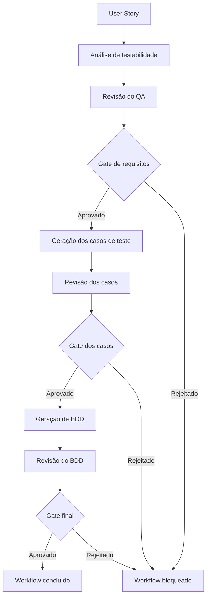

# QA AI Agent — Análise, Casos de Teste e BDD

Agente de Quality Assurance desenvolvido em Python e integrado à API da Anthropic.

O projeto analisa User Stories, avalia a testabilidade dos requisitos e utiliza gates de aprovação humana antes de gerar casos de teste e cenários BDD.

## Objetivo

Apoiar o trabalho de QA sem transformar automaticamente sugestões da inteligência artificial em requisitos.

O agente separa:

- requisitos explicitamente confirmados;
- dependências entre requisitos;
- lacunas e perguntas;
- sugestões da IA;
- avaliação de testabilidade;
- casos de teste;
- cenários BDD.

## Princípios do projeto

- A IA não deve presumir requisitos.
- Sugestões não se tornam requisitos automaticamente.
- Casos de teste somente são gerados após revisão do diagnóstico.
- BDD somente é gerado após aprovação dos casos de teste.
- O QA permanece responsável pelas decisões nos gates de qualidade.
- Campo ausente, string vazia e valor nulo não são tratados automaticamente como equivalentes.

## Workflow da V04



## Status de testabilidade

O status geral não é decidido livremente pelo modelo. Cada requisito recebe uma avaliação individual e o Python calcula o resultado:

- `READY_FOR_TESTING`
- `READY_FOR_TESTING (PARCIAL)`
- `NEEDS_CLARIFICATION`

## Validação estruturada

As respostas da IA são retornadas em JSON e validadas com Pydantic.

O projeto verifica, entre outros pontos:

- tipos e campos obrigatórios;
- dados de entrada dos casos de teste;
- quantidade real de caracteres;
- relacionamento entre requisito e caso de teste;
- rastreabilidade entre caso de teste e cenário BDD;
- casos não convertidos ou convertidos mais de uma vez.

## Gates humanos

A V04 possui três aprovações explícitas:

1. revisão do diagnóstico de testabilidade;
2. revisão dos casos de teste;
3. revisão dos cenários BDD.

A geração seguinte é bloqueada quando o QA rejeita alguma etapa.

## Evolução do projeto

| Versão | Evolução principal |
|---|---|
| `qa_agent_v01.py` | Primeira integração do agente com a API |
| `qa_agent_v02.py` | Análise de requisitos e estruturação da resposta |
| `qa_agent_v03.py` | Pydantic, testabilidade, dependências e status calculado pelo Python |
| `qa_agent_v04.py` | Workflow em fases, gates humanos, casos estruturados e BDD rastreável |

## Tecnologias

- Python 3.14.7
- Anthropic API
- Claude Sonnet
- Pydantic 2
- python-dotenv
- Ruff
- Git e GitHub

## Estrutura

```text
qa-ai-agent/
├── qa_agent_v01.py
├── qa_agent_v02.py
├── qa_agent_v03.py
├── qa_agent_v04.py
├── teste_claude.py
├── requirements.txt
├── .env.example
├── .gitignore
└── README.md
```

## Configuração do ambiente

Clone o repositório e acesse a pasta:

```powershell
git clone https://github.com/mpsuda/qa-ai-agent.git
cd qa-ai-agent
```

Crie e ative o ambiente virtual:

```powershell
python -m venv .venv
Set-ExecutionPolicy -Scope Process -ExecutionPolicy Bypass
.\.venv\Scripts\Activate.ps1
```

Instale as dependências:

```powershell
python -m pip install -r requirements.txt
```

Crie o arquivo local de configuração:

```powershell
Copy-Item .env.example .env
```

Depois edite `.env` e informe sua própria chave:

```env
ANTHROPIC_API_KEY=sua_chave_aqui
```

## Execução

```powershell
python qa_agent_v04.py
```

Durante a execução, o QA revisa e aprova ou rejeita cada etapa do workflow.

## Segurança

- A chave da API não está armazenada no código.
- O arquivo `.env` é ignorado pelo Git.
- O repositório contém apenas `.env.example`, sem credenciais reais.
- A chave é carregada por variável de ambiente.

## Exemplo de gate final

```text
GATE FINAL DO BDD:
BDD_APROVADO_PELO_QA
WORKFLOW_QA_CONCLUIDO
```

## Próximas evoluções

- modularização do projeto;
- registro estruturado das execuções;
- testes automatizados;
- integração com Playwright;
- evolução para orquestração de agentes especializados.

## Autor

**Marcos Pedro Suda**  
Quality Assurance Tester — QA, automação e inteligência artificial aplicada à qualidade.